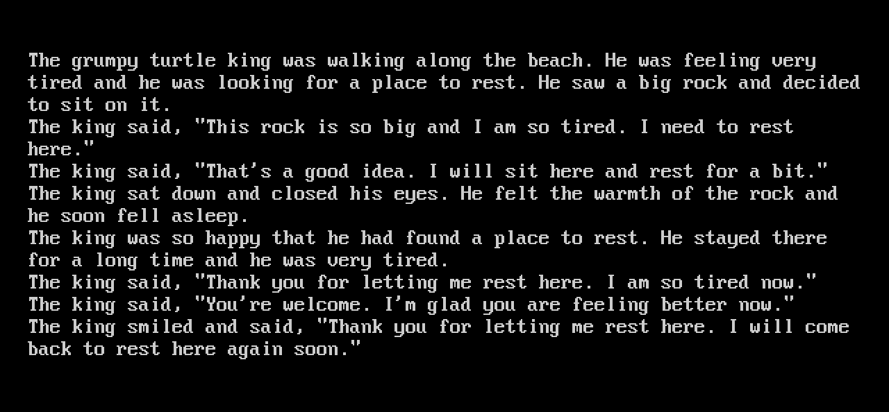

# iiama2.c

Karpathy's [llama2.c](https://github.com/karpathy/llama2.c), ported to the Nintendo Wii.

GPU prices are out of control, so we're working with what we've got: a game console from 2006, 88 MB of RAM, and a 729 MHz PowerPC. It runs TinyStories-class models (260K to ~42M params) and prints stories to the TV, controlled with the Wii Remote.

The Wii does technically have a GPU. Hollywood is fixed-function, with no shaders, but its texture combiner (the TEV) can be talked into doing 8-bit multiply-adds, so the matmuls can run there too. See [The GPU](#the-gpu).



<sub>stories15M with every matmul on the GPU (the fast engine), greedy, prompt "The grumpy turtle king". The Wii build running in Dolphin, captured by the app's own screenshot feature.</sub>

**Status:** runs in Dolphin, where the GPU path matches a bit-exact simulator. It hasn't run on a real Wii yet. If you have one, see [Running it on a real Wii](#running-it-on-a-real-wii).

## Quick start

You need a Wii with the [Homebrew Channel](https://wiibrew.org/wiki/Homebrew_Channel) and an SD card. On your PC: [uv](https://docs.astral.sh/uv/) (or Python 3 with numpy), and devkitPro or Docker.

**1. Get a model and convert it:**

```sh
mkdir -p models
curl -L -o models/stories15M.bin https://huggingface.co/karpathy/tinyllamas/resolve/main/stories15M.bin
curl -L -o models/tokenizer.bin https://raw.githubusercontent.com/karpathy/llama2.c/master/tokenizer.bin
uv run tools/export_wii.py models/stories15M.bin models/tokenizer.bin sd/llama/              # int8 (default)
uv run tools/export_wii.py models/stories15M.bin models/tokenizer.bin sd/llama/ --dtype f32  # exact fp32
```

Copy `sd/llama/` to the root of the SD card, so you have `SD:/llama/model.bin` and `SD:/llama/tokenizer.bin`.

**2. Check the files on your PC first** (optional, catches export problems before you touch the Wii):

```sh
make -C host
./host/iiama2-host sd/llama/model.bin sd/llama/tokenizer.bin -i "Once upon a time"
```

**3. Build for the Wii.** Install devkitPro with the `wii-dev` group (devkitPPC, libogc, libfat) and run `make`, or skip the install and use the official container:

```sh
make                                                              # produces iiama2.dol
docker run --rm -v "$PWD":/src -w /src devkitpro/devkitppc make   # same, no install
```

**4. Run it.** Either:

- **Over Wi-Fi:** open the Homebrew Channel, note its IP, then `export WIILOAD=tcp:<ip>` and `make run`.
- **From the SD card:** copy `iiama2.dol` to `SD:/apps/iiama2/boot.dol` along with `hbc/meta.xml`, and launch it from the Homebrew Channel.

## Controls

| Button | Action |
|---|---|
| LEFT / RIGHT | Pick a prompt |
| UP / DOWN | Temperature (0.0 = greedy, same story every time) |
| + / - | Engine: CPU, split, or GPU (see below) |
| A | Tell a story |
| B | Stop mid-story |
| 1 | Back to the menu (after a story) |
| 2 | Save a screenshot to `SD:/llama/screenshot.bmp` |
| HOME | Back to the Homebrew Channel |

Prompts live in the `PROMPTS` array at the top of `source/main.c`.

To tell a story without touching the Wii Remote, put an `autoplay.txt` in `SD:/llama/`. Optional lines: `engine N` and `prompt N` (0-based, in menu order), `temp X`, and `screenshot` to save the screen as soon as the story ends. The screenshot above is `engine 2`, `prompt 1`, `temp 0`, `screenshot`.

## The GPU

Each TEV stage computes `d ± lerp(a, b, c)` on 8-bit inputs, with an 11-bit signed register carried from stage to stage. Set it up right and that's a multiply-accumulate:

- **Weights** go in RGBA8 textures as `q + 128`, the same int8 values the CPU uses. Each framebuffer pixel holds three output rows, one per color channel.
- **Activations** go in the four konst colors, one byte per stage. Every row multiplies the same `x`, so it never needs to be a texture.
- **Stage k** is `lerp(HALF, TEXC, KONST)` with a bias that cancels the HALF, so it adds exactly `±round(q * x_k / 256)` to the running sum. Sixteen stages make a 16-column pass per draw.
- **The CPU** copies the framebuffer back and adds up the passes in float, applying the weight and activation scales.

The catch is getting an 11-bit sum out through 8-bit pixels. There are two output modes, and the engine switch picks between them:

| Engine | What runs where |
|---|---|
| CPU | Everything on the CPU, int8 weights |
| split | Transformer layers on the CPU. The GPU computes rough logits for the whole vocab, and the CPU recomputes the top 64 exactly. |
| GPU, fast | Every weight matmul on the TEV. `clamp8`: 16 columns per draw, partial sums saturate past ±128. |
| GPU, exact | `exact11`: 8 columns per draw, plus a second draw that writes the high bits, so sums are exact. About 2.4x the GPU work. |

Attention, norms and SiLU stay on the CPU in every engine.

### Accuracy

stories15M, 1,154 positions of fp32-sampled stories replayed through each engine (`tools/tev_sim/eval.py`; full report with sample stories in [`tools/tev_sim/results/stories15M.md`](tools/tev_sim/results/stories15M.md)):

| Engine | Top-1 agrees with fp32 | KL vs fp32 (nats) | Perplexity |
|---|---|---|---|
| fp32 CPU | 100% | 0 | 2.77 |
| int8 CPU | 98.4% | 0.0005 | 2.77 |
| split | 98.4% | 0.0008 | 2.77 |
| GPU, fast | 87.3% | 0.061 | 2.97 |
| GPU, exact | 96.9% | 0.0022 | 2.77 |

The split engine matches int8 CPU on top-1 and perplexity: the true best token was inside the GPU's top 64 at all 1,154 positions. GPU-fast stories wander away from the CPU's within a few dozen tokens but stay grammatical.

### Speed (predicted)

These are predictions until someone runs the bench on a real Wii. `tools/cost_model.py` costs each engine from the compiled inner loops, plus ranges for what nobody has measured yet (CPU memory bandwidth, TEV throughput). stories15M, mid-story, greedy:

| Engine | tok/s, pessimistic to optimistic | Central | vs CPU |
|---|---|---|---|
| CPU | 5.3 to 9.9 | 7.7 | 1x |
| split | 8.7 to 18.4 | 13.4 | 1.7x |
| GPU, fast | 14 to 40 | 24.9 | 3.2x |
| GPU, exact | 7.1 to 21 | 12.6 | 1.6x |

In the model, the GPU engines spend more time on the CPU's readback (summing passes) than on the GPU's own work, which is where to dig next.

## Running it on a real Wii

Put an empty `bench.txt` in `SD:/llama/` and the app runs every engine on the same greedy story at boot. It shows tok/s and the GPU time split (issuing, waiting, reading back) on screen, and writes the same to `SD:/llama/bench_out.txt`. A `steps N` line in `bench.txt` sets the story length (default 64). Delete `bench.txt` to get the normal menu back.

Nobody has done this yet. If you do, please open an issue with your `bench_out.txt`: it's the first real data point, and it pins down the unknowns in the cost model.

## Memory budget

The Wii has 24 MB MEM1 + 64 MB MEM2. After the system and the app take their share, roughly 70 MB is usable, and no single allocation can span both banks. The loader allocates every matrix separately (small ones first, the big embedding table last) so the weights pack across both.

`export_wii.py` prints an estimate for every model it converts. With the default 256-token context:

| Model | int8 (default) | fp32 |
|---|---|---|
| stories260K | ~1 MB | ~1 MB |
| stories15M | ~20 MB | ~61 MB (very tight, may not fit) |
| stories42M | ~53 MB | won't fit |
| stories110M | ~136 MB, won't fit | won't fit |

The GPU engines need their own copy of the weights as textures, about 1.4 bytes per weight. stories15M takes ~21 MB of textures on top of its ~20 MB, which fits. stories42M doesn't, so it runs CPU only (the app uploads what fits and tells you).

int8 is the default because it's about 4x smaller, and it should be faster too. Its inner loop costs ~3.3 cycles per multiply-add, because Broadway has one load/store unit and int8 needs three loads per multiply-add, versus ~2.1 cycles for fp32. But fp32 moves 4x the bytes, so it only wins if the CPU can stream memory at nearly the bus's full 1.9 GB/s, which an in-order core without prefetching shouldn't manage. Paired-singles dequantization (see below) would cut int8's loads.

The exporter caps context at 256 tokens (`--seq-len`), which is about one TV screen of text. The KV cache grows with context: at its native 1024, stories42M's cache alone would be ~34 MB and the model wouldn't fit.

stories260K uses its own 512-token tokenizer (`tok512.bin`, in the same Hugging Face repo), not the default `tokenizer.bin`. Its group size (4) is too small for the GPU path, so it's CPU only.

## Dolphin

Dolphin boots `iiama2.dol` directly and is the fastest dev loop. For SD access, point Dolphin's virtual SD card at a folder (or image) containing `llama/`. Or let a script do it:

```sh
tools/dolphin_bench.sh sd/llama > dolphin.txt   # headless bench, throwaway Dolphin profile, needs mtools
uv run tools/tev_sim/check_dolphin.py models/stories15M.bin models/tokenizer.bin dolphin.txt
```

The first line builds an SD image, runs the bench mode with the software renderer, and prints the results. The second compares them against the simulator. Three cautions:

- **Speed numbers from Dolphin are meaningless.** Its JIT runs on your desktop CPU, and GPU work finishes instantly in emulated time. Benchmark on the real console.
- **Dolphin 2606 and later won't boot a DOL with unpadded sections**, which devkitPPC's `elf2dol` produces. The Makefile pads them with `tools/pad_dol.py`.
- **Turn off Dolphin's emulated-memory override** (MEM1/MEM2 size) so you don't accidentally depend on RAM a real Wii doesn't have.

## How it was checked

Output was compared token for token, with greedy decoding and seeded sampling, against upstream llama2.c on randomly initialized checkpoints that exercise GQA, unshared classifiers, and odd group sizes. Comparisons covered:

- **Upstream vs this engine (fp32):** bit-identical text with `-DLLM_EXACT_MATMUL -ffp-contract=off`, on both x86 and big-endian 32-bit PowerPC (`qemu-ppc`, `-mcpu=750`). Also identical on stories15M itself (macOS, arm64).
- **x86 vs PowerPC:** identical text for both fp32 and int8 builds.

The GPU path was checked in layers:

- **The TEV math.** `tools/tev_sim/tev.py` follows the combiner arithmetic in Dolphin's software renderer (`Tev.cpp`), so it's only as right as Dolphin is. Real hardware is the final word.
- **The simulator against Dolphin.** Run in Dolphin, the Wii build's integer pass sums match the simulator bit for bit, for three matrix shapes in both output modes. Over 64 greedy tokens, four of the five engines tell the same story as the simulator. GPU-fast diverges at token 41, at a near-tie (the top two logits differ by 0.02, against a median gap of 1.9), where the CPU-side float rounding of numpy and C differs.
- **The simulator against the C engine.** The numpy port in `tools/tev_sim/llama.py` reproduces the C engine's greedy stories exactly, fp32 and int8.

Note that the default build sums each matmul row with 4 accumulators for speed, so its fp32 output can differ from upstream in the last bits. Build with `-DLLM_EXACT_MATMUL` if you want upstream-exact numerics.

## What's in here

| Path | What it is |
|---|---|
| `source/llm.c`, `llm.h` | The inference engine (forward pass, BPE tokenizer, sampler). Portable C, no mmap, no `exit()`. |
| `source/gx_matmul.c` | Weight matmuls on the GPU's TEV, for the split and GPU engines. |
| `source/main.c` | The Wii app: SD loading with a progress bar, prompt menu, engine switch, word-wrapped output, tok/s, bench mode, autoplay, screenshots. |
| `Makefile` | devkitPPC build (stock devkitPro Wii template + libfat). |
| `host/` | Desktop build of the same engine, for testing exported files on your PC or under `qemu-ppc`. |
| `hbc/meta.xml` | Homebrew Channel listing. |
| `tools/export_wii.py` | Converts a llama2.c checkpoint + tokenizer to big-endian files, optionally int8. Needs only numpy. |
| `tools/tev_sim/` | Bit-exact numpy simulator of the TEV math, the accuracy evaluation, and the Dolphin cross-check. |
| `tools/cost_model.py` | Predicts real-Wii tok/s for each engine. |
| `tools/dolphin_bench.sh` | Runs the bench mode headless in Dolphin. |
| `tools/pad_dol.py` | Pads DOL sections so newer Dolphin will boot them. |
| `docs/` | The screenshot. |

## Ideas for next steps

- **Overlap the CPU and GPU.** Right now the CPU waits for each batch of draws and then sums it. Double-buffering the framebuffer copy would let the CPU sum batch k while the GPU draws batch k+1. Splitting a matmul's rows between the two would put both to work.
- **Shrink the readback.** It's the biggest GPU-engine cost in the model. Ideas: sum more columns per draw before reading back, or use per-row weight scales so the CPU stops streaming per-group scales.
- **Cheaper GX calls.** libogc's TEV setters do read-modify-write on shadow state; about 3,600 instructions per pass could be a few hundred as raw register writes.
- **Paired-singles dequantization.** Broadway's `psq_l` instruction loads two int8 values and converts them to floats in hardware, scaled by a GQR register. Nintendo built it for vertex compression, and it's a near-perfect fit for int8 weights. Swapping the lookup table in `matmul_q8` for `psq_l` + `ps_madd` would cut the CPU engine's loads by more than half. Adding `dcbt` prefetches would hide some of the memory stalls.
- **Train your own.** A ~15M model trained on a narrow domain (a grumpy turtle king, say) on a single gaming GPU is more coherent and much funnier than a general one. Use a small vocab while you're at it: on stories15M, the 32000-token output layer is ~60% of the work per token, and a 4096-token vocab (llama2.c's `--vocab_source=custom`) roughly halves it. Export with llama2.c's `export.py --version 0`, then run it through `export_wii.py`.

## Credits

- [llama2.c](https://github.com/karpathy/llama2.c) by Andrej Karpathy, which the engine is ported from, and the [tinyllamas](https://huggingface.co/karpathy/tinyllamas) checkpoints.
- [TinyStories](https://arxiv.org/abs/2305.07759) by Ronen Eldan and Yuanzhi Li, the dataset those models were trained on.
- [devkitPro](https://devkitpro.org/) for devkitPPC, libogc and libfat.
- [Dolphin](https://dolphin-emu.org/), whose software renderer is the reference for the TEV math, and which ran every line of this before any real Wii did.

## License

MIT, same as llama2.c. See [LICENSE](LICENSE).
