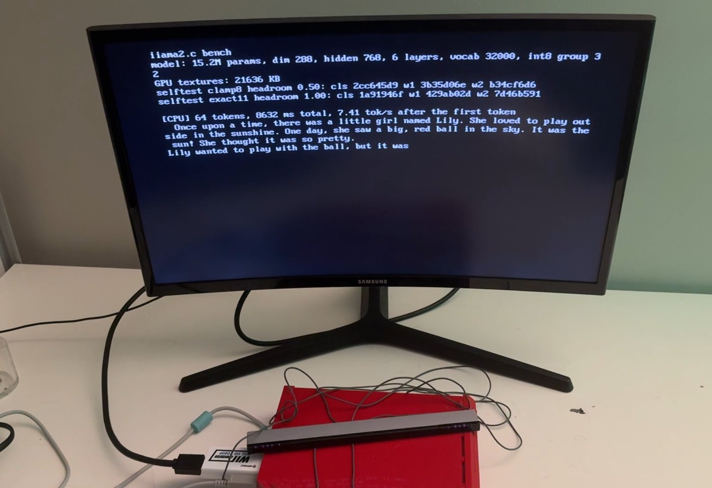

# iiama2.c

Karpathy's [llama2.c](https://github.com/karpathy/llama2.c), ported to the Nintendo Wii.

GPU prices are out of control, so we're working with what we've got: a game console from 2006, 88 MB of RAM, and a 729 MHz PowerPC. It runs TinyStories-class models (260K to ~42M params) and prints stories to the TV, controlled with the Wii Remote.

The Wii does technically have a GPU. Hollywood is fixed-function, with no shaders, but its texture combiner (the TEV) can be talked into doing 8-bit multiply-adds, so the matmuls can run there too. See [The GPU](#the-gpu).



<sub>The first run on real hardware: stories15M on the CPU engine, on a TV through an HDMI adapter. The GPU engines told garbage stories on that run (the self-test hashes on screen are wrong); see [Dolphin vs a real Wii](#dolphin-vs-a-real-wii) for why.</sub>

**Status:** runs on a real Wii, where the GPU path matches a bit-exact simulator. The fastest engine does 43.5 tok/s with stories15M, 5.9x the CPU alone. See [Speed](#speed-on-a-real-wii).

## Quick start

You need a Wii with the [Homebrew Channel](https://wiibrew.org/wiki/Homebrew_Channel) and an SD card. On your PC: [uv](https://docs.astral.sh/uv/) (or Python 3 with numpy), and devkitPro or Docker.

**1. Get a model and convert it:**

```sh
mkdir -p models
curl -L -o models/stories15M.bin https://huggingface.co/karpathy/tinyllamas/resolve/main/stories15M.bin
curl -L -o models/tokenizer.bin https://raw.githubusercontent.com/karpathy/llama2.c/master/tokenizer.bin
uv run tools/export_wii.py models/stories15M.bin models/tokenizer.bin sd/llama/              # int8 (default)
uv run tools/export_wii.py models/stories15M.bin models/tokenizer.bin sd/llama/ --dtype f32  # exact fp32
```

Copy `sd/llama/` to the root of the SD card, so you have `SD:/llama/model.bin` and `SD:/llama/tokenizer.bin`.

**2. Check the files on your PC first** (optional, catches export problems before you touch the Wii):

```sh
make -C host
./host/iiama2-host sd/llama/model.bin sd/llama/tokenizer.bin -i "Once upon a time"
```

**3. Build for the Wii.** Install devkitPro with the `wii-dev` group (devkitPPC, libogc, libfat) and run `make`, or skip the install and use the official container:

```sh
make                                                              # produces iiama2.dol
docker run --rm -v "$PWD":/src -w /src devkitpro/devkitppc make   # same, no install
```

**4. Run it.** Either:

- **Over Wi-Fi:** open the Homebrew Channel, note its IP, then `export WIILOAD=tcp:<ip>` and `make run`.
- **From the SD card:** copy `iiama2.dol` to `SD:/apps/iiama2/boot.dol` along with `hbc/meta.xml`, and launch it from the Homebrew Channel.

## Controls

| Button | Action |
|---|---|
| LEFT / RIGHT | Pick a prompt |
| UP / DOWN | Temperature (0.0 = greedy, same story every time) |
| + / - | Engine: CPU, split, or GPU (see below) |
| A | Tell a story |
| B | Stop mid-story |
| 1 | Back to the menu (after a story) |
| 2 | Save a screenshot to `SD:/llama/screenshot.bmp` |
| HOME | Back to the Homebrew Channel |

Prompts live in the `PROMPTS` array at the top of `source/main.c`.

To tell a story without touching the Wii Remote, put an `autoplay.txt` in `SD:/llama/`. Optional lines: `engine N` and `prompt N` (0-based, in menu order), `temp X`, and `screenshot` to save the screen as soon as the story ends. The Dolphin screenshot [below](#dolphin) is `engine 2`, `prompt 1`, `temp 0`, `screenshot`.

## The GPU

Each TEV stage computes `d ± lerp(a, b, c)` on 8-bit inputs, with an 11-bit signed register carried from stage to stage. Set it up right and that's a multiply-accumulate:

- **Weights** go in RGBA8 textures as `q + 128`: the same int8 values the CPU uses, or for GPU fast, those weights requantized with one scale per row. Each framebuffer pixel holds three output rows, one per color channel.
- **Activations** go in the four konst colors, one byte per stage. Every row multiplies the same `x`, so it never needs to be a texture.
- **Stage k** is `lerp(HALF, TEXC, KONST)` with a bias that cancels the HALF, so it adds exactly `±round(q * x_k / 256)` to the running sum. Sixteen stages make a 16-column pass per draw. Stage 0 starts the sum from a constant rather than from the PREV register, because a real Wii doesn't reset PREV between pixels.
- **The CPU** copies the framebuffer back and adds up the passes in float, applying the weight and activation scales.
- **The output layer** lets the framebuffer do that sum instead. Every pass draws into the same pixels and the blend unit adds it in, so the CPU reads one byte per row instead of one per pass. Blending can only add or subtract 8-bit pixels, clamped to 0..255, so the passes alternate: even passes add `c + P`, odd passes flip every stage's sign and subtract `c - P`, and the constant offsets `c` cancel in pairs. That takes one weight scale per row and one activation scale per token, and an 8-bit total is coarse, so the CPU recomputes the top 256 rows exactly.

The catch is getting an 11-bit sum out through 8-bit pixels. There are two output modes, and the engine switch picks between them:

| Engine | What runs where |
|---|---|
| CPU | Everything on the CPU, int8 weights |
| split | Transformer layers on the CPU. The GPU computes rough logits for the whole vocab (blended), and the CPU recomputes the top 256 exactly. |
| GPU, fast | Every weight matmul on the TEV. `clamp8`: 16 columns per draw, partial sums saturate past ±128, one weight scale per row. |
| GPU, exact | `exact11`: 8 columns per draw, plus a second draw that writes the high bits, so sums are exact. About 2.4x the GPU work. |

Both GPU engines run the output layer like split does. Attention, norms and SiLU stay on the CPU in every engine.

GPU fast leans on more of the hardware:

- **One weight scale per row.** Its layers get their own textures, requantized from the CPU's per-group int8. Measured against each row's largest weight, most weights get smaller, so pass sums saturate 0.3% of the time instead of 1.8%, which more than pays for the coarser scale. It also means the readback doesn't stream any weight scales.
- **Paired singles for the readback.** Broadway's `psq_lx` loads framebuffer bytes and converts them to floats in hardware (a GQR register says they're `u8`), and `ps_madds0` updates two rows in one instruction.
- **Raw register writes.** Per pass, only the konst colors, the stages' add/subtract ops and the texture addresses change, so they go straight down the write-gather pipe as GPU register writes instead of through libogc's setters.
- **Pipelining.** Passes go in chunks of six, each copied out behind a draw-sync token, so the CPU sums one chunk while the GPU draws the next.
- **MEM1 for the copies.** The CPU reads MEM1 almost three times faster than MEM2, so a small buffer for framebuffer copies is reserved there before the model loads.

### Accuracy

stories15M, 1,154 positions of fp32-sampled stories replayed through each engine in the simulator, which the Wii's GPU matches bit for bit (`tools/tev_sim/eval.py`; full report with sample stories in [`tools/tev_sim/results/stories15M.md`](tools/tev_sim/results/stories15M.md)):

| Engine | Top-1 agrees with fp32 | KL vs fp32 (nats) | Perplexity |
|---|---|---|---|
| fp32 CPU | 100% | 0 | 2.77 |
| int8 CPU | 98.4% | 0.0005 | 2.77 |
| split | 98.4% | 0.0046 | 2.78 |
| GPU, fast | 92.2% | 0.027 | 2.84 |
| GPU, exact | 97.0% | 0.0054 | 2.78 |

The split engine matches int8 CPU on top-1 and tells the same greedy stories: the true best token was inside the blended output layer's top 64 at all 1,154 positions. KL is higher than int8's because tokens outside the top 256 keep their coarse logits. At the app's sampling settings (temperature 0.8, top-p 0.9), the sampling distribution sits nearly as close to fp32's as int8 CPU's does (total variation 0.010 vs 0.009, `tools/tev_sim/blend_sweep.py`). GPU-fast stories wander away from the CPU's within a few dozen tokens but stay grammatical. Before its layers got per-row scales, GPU fast scored 90.0% and 0.040.

### Speed on a real Wii

stories15M, int8, the bench's 64-token greedy story (see [below](#running-it-on-a-real-wii)):

| Engine | tok/s | vs CPU | with blending | first run |
|---|---|---|---|---|
| CPU | 7.41 | 1x | 7.41 | 7.41 |
| split | 15.38 | 2.1x | 15.34 | 12.29 |
| GPU, fast | 43.51 | 5.9x | 30.01 | 20.55 |
| GPU, exact | 20.62 | 2.8x | 17.36 | 9.46 |

The first run summed every pass on the CPU. Blending the output layer's passes in the framebuffer came next, then GPU fast's per-row scales, paired-single readback, raw register writes, pipelining and MEM1 copies ([above](#the-gpu)). Where a GPU-fast token's time goes:

| | now (23 ms) | with blending (33 ms) | first run (49 ms) |
|---|---|---|---|
| CPU issuing GX commands | 1.7 | 4.7 | 4.6 |
| CPU waiting for the GPU | 9.7 | 9.6 | 9.9 |
| CPU reading the framebuffer back and summing passes | 5.0 | 12.9 | 29.0 |
| Everything else (attention, norms, SiLU, recomputing the top 256) | 6.6 | 6.0 | 5.1 |

Most of the waiting is the output layer, 6.4 ms of GPU time held back by texture fetch (below). The readback still costs about 21 cycles per pixel and pass against the 5 its instructions need, in cache misses on the copy. `tools/cost_model.py` is fitted to these runs and reproduces every engine within 2.5%. Fitted to the first run, it predicted blending's speedups within 4% before the code was written; it missed this last round by 17%, on the readback's misses and about 2.6 µs of GPU time per draw that nothing measured yet explains.

### What the probes measured

`probe.txt` also times things that only the hardware can answer:

- **The TEV isn't the limit; texture fetch is.** With no texture, or one small texture that stays in the cache, the output layer's 18 passes take 3.2 ms: 951 million pixel-stages a second, four pixels per GPU clock. Fetching the real RGBA8 textures from MEM2 doubles that to 6.4 ms. The same memory read as a 16-bit format (RGB565) takes 4.4 ms, and as an 8-bit one 3.9.
- **MEM2 is slow for the CPU.** Streaming reads run at 408 MB/s from MEM1 and 147 MB/s from MEM2. `dcbt` prefetching doesn't help either.
- **Raw register writes** cost 1.7 µs per pass against 3.3 through libogc, with identical results. Draw-sync tokens work for pipelining.
- **Locked-cache DMA crashes.** Broadway can lock half its L1 cache as a scratchpad and DMA into it, but on a Wii, libogc's `LCLoadData` ended in a Machine Check exception.

## Running it on a real Wii

Put an empty `bench.txt` in `SD:/llama/` and the app runs every engine on the same greedy story at boot. It shows tok/s and the GPU time split (issuing, waiting, reading back) on screen, and writes the same to `SD:/llama/bench_out.txt`. A `steps N` line in `bench.txt` sets the story length (default 64). Delete `bench.txt` to get the normal menu back. To check a bench run against the simulator:

```sh
uv run tools/tev_sim/check_dolphin.py models/stories15M.bin models/tokenizer.bin bench_out.txt
```

If the GPU engines disagree with the CPU, put an empty `probe.txt` in `SD:/llama/` as well. The app then runs `source/gx_probe.c` first: small draws that test texture sampling, the konst registers, a color register's value and how out-of-range pixels are written, one multiply-add stage over every weight byte, the exact11 halving stages and blending, plus raw dumps of real matmuls (each hashed three times, and two of them dumped as floats), then the timings above. It writes `SD:/llama/probe.bin` and `probe_out.txt`, and this says what came out different and how:

```sh
uv run tools/tev_sim/check_probe.py models/stories15M.bin probe.bin
```

That's how the difference below was found. If you run it on a Wii U in Wii mode, an issue with your `bench_out.txt` and probe results would be interesting.

## Memory budget

The Wii has 24 MB MEM1 + 64 MB MEM2. After the system and the app take their share, roughly 70 MB is usable, and no single allocation can span both banks. The loader allocates every matrix separately (small ones first, the big embedding table last) so the weights pack across both.

`export_wii.py` prints an estimate for every model it converts. With the default 256-token context:

| Model | int8 (default) | fp32 |
|---|---|---|
| stories260K | ~1 MB | ~1 MB |
| stories15M | ~20 MB | ~61 MB (very tight, may not fit) |
| stories42M | ~53 MB | won't fit |
| stories110M | ~136 MB, won't fit | won't fit |

The GPU engines need their own copy of the weights as textures, about 1.4 bytes per weight, and GPU fast keeps a second copy of the layers with per-row scales. stories15M takes ~28 MB of textures on top of its ~20 MB, which fits, with about 1 MB of MEM1 and 23 MB of MEM2 left over. stories42M doesn't, so it runs CPU only (the app uploads what fits and tells you).

int8 is the default because it's about 4x smaller, and it should be faster too. Its inner loop costs ~3.3 cycles per multiply-add, because Broadway has one load/store unit and int8 needs three loads per multiply-add, versus ~2.1 cycles for fp32. But fp32 moves 4x the bytes, so it only wins if the CPU can stream memory at nearly the bus's full 1.9 GB/s, which an in-order core without prefetching shouldn't manage. Paired-singles dequantization (see below) would cut int8's loads.

The exporter caps context at 256 tokens (`--seq-len`), which is about one TV screen of text. The KV cache grows with context: at its native 1024, stories42M's cache alone would be ~34 MB and the model wouldn't fit.

stories260K uses its own 512-token tokenizer (`tok512.bin`, in the same Hugging Face repo), not the default `tokenizer.bin`. Its group size (4) is too small for the GPU path, so it's CPU only.

## Dolphin

Dolphin boots `iiama2.dol` directly and is the fastest dev loop. For SD access, point Dolphin's virtual SD card at a folder (or image) containing `llama/`. Or let a script do it:

```sh
tools/dolphin_bench.sh sd/llama > dolphin.txt   # headless bench, throwaway Dolphin profile, needs mtools
uv run tools/tev_sim/check_dolphin.py models/stories15M.bin models/tokenizer.bin dolphin.txt
PROBE=1 tools/dolphin_bench.sh sd/llama          # the GPU probes instead; keeps probe.bin
```

The first line builds an SD image, runs the bench mode with the software renderer, and prints the results. The second compares them against the simulator.


<sub>stories15M with every matmul on the GPU (the fast engine), greedy, prompt "The grumpy turtle king". The Wii build in Dolphin, captured by the app's own screenshot feature.</sub>

Four cautions:

- **Speed numbers from Dolphin are meaningless.** Its JIT runs on your desktop CPU, and GPU work finishes instantly in emulated time. Benchmark on the real console.
- **Dolphin 2606 and later won't boot a DOL with unpadded sections**, which devkitPPC's `elf2dol` produces. The Makefile pads them with `tools/pad_dol.py`.
- **Turn off Dolphin's emulated-memory override** (MEM1/MEM2 size) so you don't accidentally depend on RAM a real Wii doesn't have.
- **Don't read a TEV register before writing it.** See below.

### Dolphin vs a real Wii

The first build matched the simulator bit for bit in Dolphin and told garbage stories on a real Wii. The probes found why: **Dolphin starts every pixel's TEV registers from the values set with `GX_SetTevColor`, but a real Wii doesn't reset PREV between pixels.** As far as the probes can tell, each pixel's PREV starts with whatever an earlier pixel left there, so the matmul's starting sum of 128 (or 0) was leftover garbage, and repeated runs of the same matmul gave different results. Everything else the probes test matched Dolphin exactly. The fix is to never read PREV before writing it: stage 0 takes its starting value from a constant input (`GX_CC_HALF`, `GX_CC_ZERO`, or the C0 register for the blended passes) instead.

## How it was checked

Output was compared token for token, with greedy decoding and seeded sampling, against upstream llama2.c on randomly initialized checkpoints that exercise GQA, unshared classifiers, and odd group sizes. Comparisons covered:

- **Upstream vs this engine (fp32):** bit-identical text with `-DLLM_EXACT_MATMUL -ffp-contract=off`, on both x86 and big-endian 32-bit PowerPC (`qemu-ppc`, `-mcpu=750`). Also identical on stories15M itself (macOS, arm64).
- **x86 vs PowerPC:** identical text for both fp32 and int8 builds.

The GPU path was checked in layers:

- **The TEV math.** `tools/tev_sim/tev.py` follows the combiner arithmetic in Dolphin's software renderer (`Tev.cpp`). The probes confirmed it on a real Wii: one multiply-add stage for all 256 weight bytes against 10 activation values in both signs, the halving stages, and out-of-range writes, which wrap like a u8 cast.
- **The simulator against Dolphin.** Run in Dolphin, the Wii build's integer outputs match the simulator bit for bit: the pass sums for two matrix shapes in both output modes, and the blended output layer's framebuffer. So do the float outputs of a whole matmul in both modes, down to the last bit, since the simulator rounds the way Broadway's fused multiply-add does. Over 64 greedy tokens, three of the four engines tell the same story as the simulator. GPU fast drifts off after about 20 tokens: it requantizes activations to 8 bits at every layer, so one rounding that goes the other way, from float differences between numpy and C outside the matmuls, gives the rest of the story different quantization noise.
- **The simulator against a real Wii.** The same integer hashes, probe images and float outputs, bit for bit. The Wii's text output is identical to Dolphin's for all four engines.
- **The simulator against the C engine.** The numpy port in `tools/tev_sim/llama.py` reproduces the C engine's greedy stories exactly, fp32 and int8.

Note that the default build sums each matmul row with 4 accumulators for speed, so its fp32 output can differ from upstream in the last bits. Build with `-DLLM_EXACT_MATMUL` if you want upstream-exact numerics.

## What's in here

| Path | What it is |
|---|---|
| `source/llm.c`, `llm.h` | The inference engine (forward pass, BPE tokenizer, sampler). Portable C, no mmap, no `exit()`. |
| `source/gx_matmul.c` | Weight matmuls on the GPU's TEV, for the split and GPU engines. |
| `source/gx_probe.c` | Hardware probes for the GPU path (`probe.txt`). |
| `source/main.c` | The Wii app: SD loading with a progress bar, prompt menu, engine switch, word-wrapped output, tok/s, bench mode, autoplay, screenshots. |
| `Makefile` | devkitPPC build (stock devkitPro Wii template + libfat). |
| `host/` | Desktop build of the same engine, for testing exported files on your PC or under `qemu-ppc`. |
| `hbc/meta.xml` | Homebrew Channel listing. |
| `tools/export_wii.py` | Converts a llama2.c checkpoint + tokenizer to big-endian files, optionally int8. Needs only numpy. |
| `tools/tev_sim/` | Bit-exact numpy simulator of the TEV math, the accuracy evaluation, and the bench and probe checkers. |
| `tools/cost_model.py` | Costs each engine on a real Wii, fitted to one. |
| `tools/dolphin_bench.sh` | Runs the bench mode headless in Dolphin. |
| `tools/pad_dol.py` | Pads DOL sections so newer Dolphin will boot them. |
| `docs/` | The photo and the Dolphin screenshot. |

## Ideas for next steps

- **Feed the TEV faster.** The output layer spends half its GPU time waiting on texture fetch. The GPU can bulk-load textures into its 1 MB of texture memory ahead of a draw (one output-layer pass is 683 KB), which might let the TEV run at its full rate. The output layer is coarse anyway, so a 16-bit texture format would also do, at 5 or 6 bits per weight.
- **Fewer, bigger draws.** q, k and v multiply the same input, and so do the FFN's w1 and w3. Stacking each group's rows into one matrix would cut GPU fast's draws per token by a third, and the cost model puts ~2.6 µs on each.
- **Paired singles for the CPU matmul.** The readback uses `psq_lx` now, but `matmul_q8` still converts int8 weights through a lookup table. `psq_l` can load two int8 values as floats in one instruction, which would cut the CPU engine's loads by more than half.
- **The locked cache, done right.** Locked-cache DMA crashed on a Wii (above). If it can be made to work, double-buffering weights through it could hide the CPU's memory stalls, which `dcbt` can't.
- **Train your own.** A ~15M model trained on a narrow domain (a grumpy turtle king, say) on a single gaming GPU is more coherent and much funnier than a general one. Use a small vocab while you're at it: on stories15M, the 32000-token output layer is ~60% of the work per token, and a 4096-token vocab (llama2.c's `--vocab_source=custom`) roughly halves it. Export with llama2.c's `export.py --version 0`, then run it through `export_wii.py`.

## Credits

- [llama2.c](https://github.com/karpathy/llama2.c) by Andrej Karpathy, which the engine is ported from, and the [tinyllamas](https://huggingface.co/karpathy/tinyllamas) checkpoints.
- [TinyStories](https://arxiv.org/abs/2305.07759) by Ronen Eldan and Yuanzhi Li, the dataset those models were trained on.
- [devkitPro](https://devkitpro.org/) for devkitPPC, libogc and libfat.
- [Dolphin](https://dolphin-emu.org/), whose software renderer is the reference for the TEV math, and which ran every line of this before any real Wii did.

## License

MIT, same as llama2.c. See [LICENSE](LICENSE).

Not affiliated with or endorsed by Nintendo. Wii is a trademark of Nintendo.
